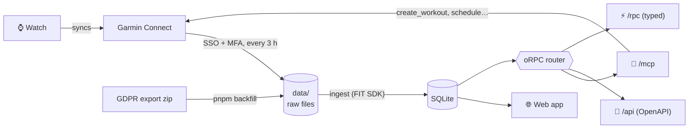

<div align="center">

# ⌚ garmin

**Your Garmin data, on your own server.**
Garmin Connect synced into SQLite, a small web app to look at it, and an MCP that lets Claude read
it and write workouts to your watch.

[](https://github.com/vafanassieff/garmin/actions/workflows/ci.yml)


</div>

---

## ✨ What it does

|     |                                                                                                                                                                                                                                                                                                                                                                        |
| --- | ---------------------------------------------------------------------------------------------------------------------------------------------------------------------------------------------------------------------------------------------------------------------------------------------------------------------------------------------------------------------- |
| 🔄  | **Syncs Garmin Connect by itself.** Logs in like the mobile app (SSO + MFA), keeps only its tokens, and pulls activities, sleep, HRV, readiness, weigh-ins and the calendar every 3 hours. The whole history on demand.                                                                                                                                                |
| 📊  | **A web app to look at it.** Today first: the night against your own 28-day normal (green, orange, red, and why), the planned workout, the day's planned burn, your notes. Then stats, runs, every activity with its route and its curves, sleep night by night. Plain SVG charts, on a dark HUD.                                                                      |
| ⚖️  | **Withings weigh-ins too.** Connect a Withings scale once (OAuth): its weight, fat, muscle, water, bone mass and visceral fat land in the same `body` table every 3 hours, on a loop of their own.                                                                                                                                                                     |
| 🤖  | **An MCP for Claude.** 34 tools: list and compare runs, a morning readiness check, training load, the planned workouts, your notes, the pains pinned on the body map, your races and their plans, the nutrition plan, the weight trend and the peak weight, your supplements, the strength programme and its sessions, your caffeine, and read-only SQL on everything. |
| 🏃  | **Workouts on the watch.** Claude creates, schedules, moves and deletes structured workouts: paces like `"6'05/km"`, HR in bpm, repeat groups, strength circuits from Garmin's catalog. Every write has a dry run.                                                                                                                                                     |
| 🧩  | **One API, three faces.** One [oRPC](https://orpc.dev) router serves the MCP (`/mcp`), OpenAPI (`/api`) and a typed RPC client (`/rpc`).                                                                                                                                                                                                                               |
| 🫀  | **A 3D body map.** Click a 3D anatomical model (lower body and trunk) exactly where it hurts: the pain goes to your journal with its structure, and Claude reads it back (`body_history`) to triage it.                                                                                                                                                                |
| 🔐  | **Private by design.** One password, or OAuth 2.1 for MCP clients. Raw files and SQLite on your disk, never in git; every secret in its own 0600 file.                                                                                                                                                                                                                 |

TypeScript and [Effect](https://effect.website) end to end, with no Python. The web app runs on
TanStack Start + React, the data on drizzle + `node:sqlite`, and FIT files go through Garmin's
own FIT SDK.

## 🏗️ How it works



- **Raw files are the source of truth.** The FIT files and Garmin Connect's JSON stay on disk.
  The database can always be rebuilt from them (`pnpm ingest --rebuild`).
- **The app owns the Garmin account.** You log in once on `/garmin` (email, password, MFA code).
  The access token is refreshed before it expires. If Garmin ever refuses the session, the web
  app and the MCP say so.
- **Writes go straight to Garmin.** After a write, the calendar months it touched are fetched
  again, so `planned_workouts` reads back exactly what the watch gets.

## 🚀 Quick start

One image, `ghcr.io/vafanassieff/garmin`, with two volumes. It holds health data, so run it on a
private network (Tailscale, say), behind a reverse proxy that terminates TLS.

```yaml
garmin:
  image: ghcr.io/vafanassieff/garmin:latest
  restart: unless-stopped
  volumes:
    - ./garmin/data:/data # raw files, SQLite
    - ./garmin/session:/session # Garmin tokens, password hash, OAuth database
  environment:
    TZ: Europe/Paris
```

1. **Create both directories**, owned by uid 1000, in 0700. The app creates every file 0600.
2. **Open `/setup` right away** and choose the app's password. Until then, whoever opens the
   app first chooses it.
3. **Log Garmin in** on `/garmin`: email, password, then the MFA code Garmin sends. The first sync
   starts at once. From a terminal instead:
   `docker exec -it <container> node src/garmin/cli.ts login`.
4. **Fetch the history**, either way:
   - the "whole history" button on `/garmin`, or
     `docker exec <container> node src/garmin/cli.ts sync --since all`;
   - Garmin's export zip dropped into `data/import/`, then
     `docker exec <container> node src/export.ts /data/import/<export>.zip`.

Every push to `main` that passes CI pushes `:latest` and `:<sha>`.

## ⚖️ Connect Withings (optional)

1. **Create a developer app** on [developer.withings.com](https://developer.withings.com/dashboard/)
   (the free public API). Its callback is the app's `/withings/callback`, exactly as `/garmin`
   shows it (`https://garmin.example.com/withings/callback`).
2. **Give the server its id and secret:** `WITHINGS_CLIENT_ID` and `WITHINGS_CLIENT_SECRET`.
   Without them, Withings stays off.
3. **Connect** on `/garmin` ("Connecter Withings"), and allow it on Withings' page. The whole
   history comes at the first sync, then the recent months every 3 hours.

Only the tokens are kept, in their own file (`WITHINGS_SESSION_PATH`, 0600). Each weigh-in is a
`body` row with `source = 'WITHINGS'`; a weigh-in the scale could not attribute (someone else on
it) is left out.

## 🤖 Connect Claude

```sh
claude mcp add --transport http garmin https://garmin.example.com/mcp
claude mcp login garmin   # the browser opens /authorize: allow it
```

Claude Code finds the app's OAuth server by itself and keeps its own tokens. `/access` lists the
apps you allowed and revokes any of them. You can also pass the app's password as a bearer
token: `--header "Authorization: Bearer <password>"`.

<details>
<summary><b>The 34 tools</b></summary>

**Your data (read-only)**

- `list_activities`, `get_activity` (laps, zones, km splits), `compare_runs`.
- `daily_readiness`, with 28-day baselines.
- `weekly_load`: acute and chronic load.
- `planned_workouts`.
- `sync_status`: the Garmin session, the last syncs, how fresh the data is.
- `schema` and `sql`: one read-only SQLite statement per call. It is enforced by SQLite itself
  (read-only connection, `query_only`, an authorizer that only allows reads) and runs in its own
  process, killed after 30 s.

**Your journal**

- `log_note`: a note in your words (a pain, how a run felt, a meal), on a day. One file each in
  `data/journal/`, shown on the home page for 14 days, in the `journal` table for the SQL. A pain
  can carry a `body`: the structure of the anatomy model (e.g. `vastus_lateralis_r`), its side,
  the point clicked, the intensity 0-10, its kind, when it hurts and since when. It is checked
  against the model's catalog when written.
- `body_history`: the pains pinned over a period, with their structures' French, English and
  Latin names, and per structure its intensity note by note, in day order, and its trend.

**Your caffeine** (one file per drink in `data/caffeine/`, the `caffeine` table for the SQL)

- `log_caffeine`: a drink and its time ("un double expresso à 15h"), its mg from a cited catalog
  (espresso 63, filtre 95, thé noir 47…) or given. The Café card on the home page logs the usual
  ones in one tap, and the last tap can be undone.
- `delete_caffeine`: one intake logged by mistake, by its time: its file, then its row.
- `caffeine_today`: the day's total against EFSA 2015's limits (400 mg a day, 200 mg at once), the
  caffeine in the body now and at bedtime (an estimate: a 5 h half-life), and the cut-off for the
  last coffee (a 95 mg coffee down to 25 mg by 23:30), beside the 8.8 h rule of Gardiner et al. 2023.
- `caffeine_vs_sleep`: per night, the caffeine left at sleep onset and the last intake, against the
  sleep score, HRV, resting HR and deep sleep; nights over 50 mg against the others once there are
  10 of each. An association, never a cause. `/cafe` shows it with 30 days of history.

**Your races** (files in `data/races/`, read on each call)

- `add_race`: a target race from its GPX (a track or a route; without altitudes, they are read
  from the elevation tiles), with its start time, aid stations and cutoffs; with its slug, its
  facts or course replaced.
- `list_races`, `get_race`: the course cut into climbs, descents and flats (km-effort, grades), and
  the predicted times: your best run of the year carried to the race's grade-adjusted distance,
  then the passing times at each aid station and cutoff, and the gels on the timeline.
- `plan_race`: the plan agreed with Claude: a pace or HR target, food and notes per segment, carbs
  and water per hour.

**Your nutrition** (the plan in `data/nutrition/plan.json`, the supplements in
`data/nutrition/supplements.json`, read on each call)

- `nutrition_plan`, `set_nutrition_plan`: the plan agreed with Claude: kcal per day type (rest,
  easy, quality, long), carbs per hour during a long run, protein a day, the weekly loss aimed for
  and when to call it stalled, the target weight, the phases (deficit, maintenance). Without the
  file, the plan of 2026-11-16.
- `nutrition_today`: the day's type (from what was done, else planned) and its target, the phase,
  and the weight trend: the slope of the 7-day mean over the last 28 days of the phase, and on
  track, too fast, slow, stalled or not enough weigh-ins. Then today's supplements by moment and
  each nutrient's daily average against its EFSA upper limit; the peak weight (the last 14 days'
  lean mass at 10–13 % body fat, and the range under the scale's ±5 points of error) and the
  plan's target, each with its gap and dates at the plan's pace; and the levers, ranked, each
  with its number and window from your data.
- `supplements`, `set_supplements`: the supplements you take, the whole list at once: brand,
  dose and moments (breakfast, lunch, dinner, bedtime, with a run), contents per serving, daily or
  every N days, start and stop.

**Your strength training** (the programme in `data/strength/program.json`, read on each call)

- `strength_program`, `set_strength_program`: the programme agreed with Claude, sent whole: two
  sessions a week 48 h apart, the phases tied to the races (base, the marathon build, the taper
  halving the sets, Mont-Blanc's eccentric work), each exercise's doses (sets, reps or seconds,
  tempo, load cue), its Garmin catalog key (exact, or the closest one, the real exercise named in
  the step's note), its muscles as the anatomy model's structures (checked against the model),
  its regression and a home variant. Without the file, the runner's programme of 2026-11-24.
- `strength_history`: the sessions per week against the target, each exercise's progression
  (top load, Epley's estimated 1RM, volume, seconds held), the last session's sets.
- `schedule_strength`: a week's sessions placed around its runs (never the day before a quality
  session or a long run, best right after the quality session, 48 h apart), the pain rule (a
  structure pinned at 3/10 or more in 14 days regresses the exercise that loads it), then pushed
  to the Garmin calendar through `create_workout`. Its dry run calls nothing on Garmin.

**The watch** (these change the real Garmin account)

- `create_workout`: runs with pace or HR targets, warm-up, cool-down, repeat groups, and
  strength circuits checked against Garmin's catalog. It can be scheduled on dates.
- `schedule_workout`.
- `unschedule_workout`: one calendar entry, named by its id, date and exact name.
- `delete_workout`: one workout, named by its id and exact name. Nothing is ever deleted by
  pattern.
- `list_workouts` and `find_exercises` help write them.

Every write takes `dry_run: true`, which returns the exact requests and sends nothing. A write is
never retried, so a workout is never created twice. The payloads match Garmin's workout editor,
step for step.

</details>

## 🧩 API

The same procedures, wherever you need them, behind the same auth (the web session, or a bearer
token: the password or an OAuth token).

| Face    | Path                                    | For                                                                                     |
| ------- | --------------------------------------- | --------------------------------------------------------------------------------------- |
| MCP     | `/mcp`                                  | Claude and other MCP clients (streamable HTTP, stateless)                               |
| OpenAPI | `/api`, document at `/api/openapi.json` | anything REST: `GET /api/activities`, `POST /api/workouts`, `DELETE /api/workouts/{id}` |
| RPC     | `/rpc`                                  | the web pages and scripts, fully typed                                                  |

```ts
import { createORPCClient } from '@orpc/client'
import { RPCLink } from '@orpc/client/fetch'
import type { RouterClient } from '@orpc/server'

import type { Router } from './src/api/router.ts'

const garmin: RouterClient<Router> = createORPCClient(
  new RPCLink({
    origin: 'https://garmin.example.com',
    url: '/rpc',
    headers: { authorization: `Bearer ${token}` },
  })
)

await garmin.workouts.create({
  name: "Plan - tue 03/11 - Easy 40'",
  sport: 'running',
  steps: [{ duration: '40:00', hr: { low: 120, high: 150 } }],
  schedule: ['2027-01-13'],
})
```

The inputs are Effect schemas, used for both validation and JSON Schema. An error the caller can
act on answers `BAD_REQUEST` with a readable message.

## 🛠️ Development

```sh
pnpm install
pnpm dev                # :3000 (needs DATABASE_PATH and DATA_DIR; secrets default to .tokens/)
pnpm test               # vitest
pnpm check              # format, lint, types
```

| Command                                      | What                                                               |
| -------------------------------------------- | ------------------------------------------------------------------ |
| `pnpm garmin login \| status \| logout`      | the Garmin session, from a terminal                                |
| `pnpm garmin sync [--since YYYY-MM-DD\|all]` | one sync now; `all` fetches the whole history, paced               |
| `pnpm ingest [--rebuild]`                    | ingest `data/` now, or rebuild SQLite from scratch                 |
| `pnpm backfill <export.zip>`                 | import Garmin's "Export your data" zip                             |
| `pnpm db:generate <name>`                    | the next migration of `src/schema.ts` (into `drizzle/`)            |
| `pnpm db:generate:auth <name>`               | the next migration of `src/oauth/schema.ts` (into `drizzle-auth/`) |

A one-off script provides the smallest part of `src/app.ts` it needs, then runs on Node with
`runMain` from `src/main.ts` (a failure is logged and exits 1):

```ts
import { Console, Effect } from 'effect'

import { Garmin } from './src/app.ts'
import { GarminWorkouts } from './src/garmin/workouts.ts'
import { runMain } from './src/main.ts'

GarminWorkouts.use((workouts) => workouts.library({ limit: 10 })).pipe(
  Effect.tap(Console.log),
  Effect.provide(Garmin),
  runMain
)
```

> Garmin rate-limits logins per address: from a laptop the SSO may answer 429 (or a Cloudflare
> 403). Log in from the server's web app.

---

## 📚 Reference

<details>
<summary><b>🔐 Security</b></summary>

- **The Garmin session.** Only its OAuth2 tokens are kept, in their own file
  (`GARMIN_SESSION_PATH`, 0600 in a 0700 directory). They are never stored in SQLite (which the
  MCP's SQL reads) or in `data/`, and never logged. The Garmin password is never stored.
- **The Withings session.** The same: its tokens only, in `WITHINGS_SESSION_PATH` (0600 in a
  0700 directory), each rotated refresh token saved before its access token is used. The
  developer app's secret comes from the environment, never from a file the app writes.
- **One password** guards the app.
  - It is chosen on `/setup` (12 characters at least) and changed on `/password`.
  - Only its scrypt hash is kept (`PASSWORD_PATH`).
  - Changing it logs out every other browser, the MCP and every OAuth grant.
  - Logging out ends every browser's session, a copied cookie included.
- **Throttling.** Wrong passwords are limited to 10 a minute per client, 60 a minute in all, and
  2 checks at a time.
- **Every answer** refuses a POST from another site (CSRF), and carries
  `frame-ancestors 'none'`, `nosniff`, HSTS and `no-store`.
- **OAuth 2.1 for MCP clients.**
  - Discovery (RFC 9728, RFC 8414) and dynamic registration (RFC 7591, throttled).
  - A consent page behind the web session, then PKCE S256.
  - Access tokens last an hour; refresh tokens last 30 days and are rotated at each use. A spent
    refresh token that comes back revokes its grant.
  - Grants live in their own SQLite file (`AUTH_DATABASE_PATH`, via drizzle), tokens as their
    SHA-256 only.

</details>

<details>
<summary><b>🗂️ <code>data/</code> layout</b></summary>

| Path                                       | What                                                                           | From         |
| ------------------------------------------ | ------------------------------------------------------------------------------ | ------------ |
| `fit/YYYY/<activityId>.fit`                | the activity's original FIT file                                               | sync, export |
| `fit/unmatched/<file>.fit`                 | export FIT files no Garmin Connect activity matches (kept, not ingested)       | export       |
| `connect/activities/YYYY/<id>.json`        | Garmin Connect's activity summary (name, load, training effect, gear)          | sync         |
| `connect/activities/YYYY/<id>.export.json` | the export's summary of the activity, used when the API's is missing           | export       |
| `connect/strength/YYYY/<id>.json`          | a strength session's exercise sets, as Garmin Connect has them                 | sync         |
| `connect/daily/YYYY/<date>.json`           | one day: stats, sleep, HRV, training readiness, max metrics                    | sync         |
| `connect/body/YYYY-MM.json`                | a month of weigh-ins and body composition                                      | sync         |
| `withings/YYYY-MM.json`                    | a month of Withings measure groups, as getmeas returned them                   | sync         |
| `connect/calendar/YYYY-MM.json`            | a month of the Garmin calendar (scheduled workouts)                            | sync         |
| `journal/YYYY/<instant>.json`              | one note of your journal                                                       | `log_note`   |
| `caffeine/YYYY/<instant>.json`             | one drink with caffeine (time, kind, mg, note), from the MCP or the Café card  | the MCP      |
| `connect/workouts/<workoutId>.json`        | a workout's steps                                                              | sync         |
| `races/<slug>.gpx`, `.json`, `.plan.json`  | a race's course, its facts, its plan (read on each request, not in SQL)        | `add_race`   |
| `nutrition/plan.json`                      | the nutrition plan (read on each request, not in SQL)                          | the MCP      |
| `strength/program.json`                    | the strength programme (read on each request, not in SQL)                      | the MCP      |
| `nutrition/supplements.json`               | the supplements taken (read on each request, not in SQL)                       | the MCP      |
| `terrain/<area>/{z}/{x}/{y}.png`           | local elevation tiles (terrarium) and their `tiles.json`, served at `/terrain` | by hand      |
| `export/<zip>/…`                           | the export's wellness JSON files, as extracted                                 | export       |
| `anatomy/runner.glb`, `structures.json`    | the body map's 3D model and its catalog (CC BY-SA 4.0, see its README)         | by hand      |
| `garmin.db`                                | SQLite, rebuilt from the above                                                 | ingest       |

</details>

<details>
<summary><b>🧮 Schema</b></summary>

Conventions:

- Timestamps are ISO 8601 UTC text, local times `YYYY-MM-DDTHH:MM:SS`, days `YYYY-MM-DD` (the
  watch's local day).
- Units are metres, seconds and m/s.

Tables and views:

- `activities`: one row per activity.
  - Its identity and time: sport, name, start (UTC and local).
  - Its effort: distance, ascent, HR, speed, cadence, power, calories.
  - Garmin's analysis: training load and effect, time in each HR zone (with the zone bounds).
  - The rest: gear, start point, and a simplified polyline for maps.
- `laps`: durations, distance, HR, speed, cadence, power, intensity, and the workout step run.
- `samples`: one row per second (lat, lon, alt, hr, speed, cadence, power, distance),
  `WITHOUT ROWID`.
- `strength_sets`: a strength session's active sets in order: the exercise as Garmin's catalog
  keys, reps, weight, duration; Garmin Connect's (as corrected there) over the FIT file's.
- `daily`: one row per day.
  - Recovery: sleep (times, stages, score), overnight HRV and its status, resting HR, body
    battery.
  - Activity: steps, stress, intensity minutes.
  - Garmin's verdicts: training readiness, recovery time left (hours), VO2max, race predictions.
- `body`: weigh-ins with body composition, Garmin's and Withings' (`source = 'WITHINGS'`, which
  wins a weigh-in both have).
- `planned_workouts`: the Garmin calendar, with each entry's id, its workout's id and its steps.
- `journal`: your notes (`log_note`), one file each in `data/journal/`; `body` (JSON) for a pain
  pinned on the body map.
- `caffeine`: what you drank (`log_caffeine`), one file each in `data/caffeine/`: time (its key),
  day (Paris), kind, mg, note.
- `raw_files`, `sync_runs`: what was ingested, and each sync with Garmin Connect.
- Views: `activity_summary` (paces, minutes, zones in minutes), `weekly` (per ISO week and sport).

</details>

<details>
<summary><b>🧱 Modules</b></summary>

```
src/
  garmin/
    sso.ts              Garmin's SSO: login (mobile, then portal), MFA, ticket → tokens, refresh
    session.ts          the session's tokens (0600), refreshed under a lock
    api.ts              Garmin Connect's API; writes never retried
    sync.ts             Garmin Connect → data/ → ingest, the 3-hour loop
    login.ts            the login's two steps, for the web and the CLI
    workout-builder.ts  workout inputs (paces, HR, durations, exercises) → Garmin's JSON
    workouts.ts         create / schedule / unschedule / delete, then refresh the calendar
    cli.ts              pnpm garmin login | status | logout | sync
  api/                  oRPC: garmin.ts (public procedures = MCP tools), web.ts (the pages'),
                        handlers.ts (/mcp, /api, /rpc), client.ts (the pages' typed client)
  oauth/                the MCP's OAuth server: schema, service, consent page, metadata
  races/                the races: gpx.ts, course.ts (profile, segments), pacing.ts, race.ts (the
                        files and get_race's view), terrarium.ts (elevation tiles), all without
                        I/O; races.ts and terrain.ts (data/races, data/terrain, AWS tiles)
  app.ts                the app's layers, composed once: Storage, Garmin, Withings, Services, App
  main.ts               the Node platform and runMain, for the CLIs and one-off scripts
  schema.ts, db.ts      drizzle schema and the SQLite connection, migrated at startup
  fit.ts, connect.ts    FIT files and Garmin Connect's JSON → rows
  ingest.ts, export.ts  data/ → SQLite; the GDPR export zip → data/
  reader.ts             the MCP's read-only SQL, in a child process killed past 30 s
  tools.ts, stats.ts    the MCP's and the web pages' queries
  auth.ts               the password, the session cookie, the gate in front of everything
  journal/              the journal: a note and its pinned pain (note.ts), the writer (log.ts),
                        the body history (history.ts)
  caffeine/             an intake and the drink catalog (intake.ts), the decay, cut-off and views
                        (kinetics.ts), caffeine against the nights (sleep.ts), all without I/O;
                        caffeine.ts (the writer, the views)
  nutrition/            the nutrition plan (plan.ts), the day's type (day-type.ts), the weight
                        trend (trend.ts), the supplements (supplements.ts), the peak weight
                        (peak.ts) and its levers (levers.ts), all without I/O; nutrition.ts (the
                        files, the view)
  strength/             the strength programme (program.ts), the week's placement (schedule.ts),
                        the sets from Connect and FIT (sets.ts), the history (history.ts), the
                        pain rule (pain.ts), a session as a workout (workout.ts), all without I/O;
                        strength.ts (the programme's file, the week, the page's view)
  anatomy/              the body map's model: its catalog, search and checks (catalog.ts), the
                        files in DATA_DIR/anatomy served read-only (anatomy.ts)
  routes/               TanStack Start pages and endpoints
  components/           the pages' charts (plain SVG) and formats, the race's 3D map (MapLibre), the body map's 3D scene
```

</details>

<details>
<summary><b>🌐 Web pages</b></summary>

- `/`: the connection at a glance, then today: the night against its 28-day normal (green, orange
  or red, and why), the planned workout, the day's planned burn and the plan's protein, your
  journal; a strength session planned today, with its exercises. The last 7 days against the 7 before, the last night, hours per week by sport, and HRV,
  resting HR and sleep over 28 days.
  Under today, the Café card: one tap per usual drink, the day's mg, what is left now and at
  bedtime, the cut-off for the last coffee.
- `/runs`: running over 26 or 52 weeks, or all of it.
  - Volume: km per week and the time per HR zone.
  - Each run's pace, and the longest run.
  - VO2max and race predictions.
- `/activities`, `/activities/$id`: every activity, then one in full.
  - Its numbers and its route (drawn from its polyline, no map tiles).
  - Its pace, HR and altitude on one crosshair.
  - Its kilometres and laps.
- `/sleep`: over 30, 90 or 365 nights, or all of them.
  - The last night.
  - The period against the one before.
  - The stages and the schedule night by night.
  - HRV against its baseline, and body battery.
- `/races`, `/races/$slug`: the races you prepare, a GPX upload, then one race:
  - Its course in 3D on its relief (MapLibre, the elevation tiles of `data/terrain/` or AWS
    Terrain Tiles, no basemap vendor), colored by grade, with a flight along it.
  - Its profile, one cursor with the map.
  - The plan per segment, the passing times, the cutoffs' margins and the gels.
- `/body`: the body map, a 3D anatomical model (react-three-fiber) to click where it hurts.
  - Hover names a structure in French, a click pins a pain at that point: intensity, kind, when,
    since when, a note. It goes to the journal.
  - Layers peel off (fascias, muscles, tendons, ligaments, bones) and a side can be hidden, to
    reach the deep structures; a search and a list do the same without the 3D view.
  - The pains of the last 7, 30 or 90 days glow on their structures, by intensity.
  - The model (`data/anatomy/`, outside git) is served by `/anatomy/runner.glb` and
    `/anatomy/structures.json`; without it the page says so. Its credits (CC BY-SA) are on the
    page.
- `/renfo`: strength training, at the gym or at home.
  - The next session and how to start it on the watch; this week's and next week's sessions placed
    around the runs, the days set aside and why.
  - The 3/10 rule: the exercises that load a structure pinned at 3/10 or more in 14 days, and
    their regressions.
  - What the week works on the 3D model (primary and secondary muscles), the pains over it.
  - Sessions per week against 2, each exercise's progression, the last session; without any, how
    to start.
  - The programme's sessions with the phase's doses, tempo, load and muscles.
- `/nutrition`: weight and nutrition, over 90 days or a year.
  - Today's target: the day's type (rest, easy, quality, long) from the planned or done session,
    its kcal, the protein, carbs per hour during a long run.
  - The weight trend against the plan (on track, too fast, slow, stalled, not enough weigh-ins),
    and the phase with its end.
  - Today's supplements by moment, the every-N-days ones with their next dose, and each
    nutrient's daily average against its upper limit (over it said in words).
  - Each weigh-in, its 7-day mean and the deficit's corridor.
  - The peak weight: a range from the lean mass, with the scale's error, the gap and the dates at
    the plan's pace, the plan's target as the near step, the 10 % floor; and the ranked levers.
  - Fat and muscle mass.
- `/cafe`: caffeine: today's card and its curve to bedtime, 30 days of mg and of last coffees
  against the cut-off, and the nights compared once there are 10 a side.
- `/garmin`: the connection, the login, sync now, the whole history, and the last syncs.
- `/access`: the apps allowed on the MCP, each revocable.
- `/setup`, `/login`, `/password`: the app's password.

</details>
